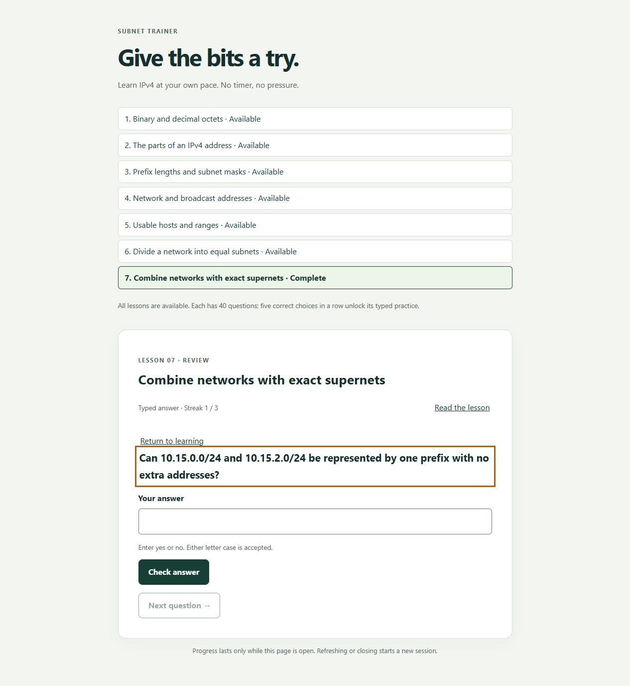

# Specification Review: Subnet Trainer

**Reviewed**: 2026-10-13
**Scope**: Current specification, including forty-question pools, immediately available lessons,
and per-lesson typed unlocking after five consecutive correct multiple-choice answers.

## Result

The implemented feature flows match the current functional specification in the reviewed
code, automated checks, and targeted browser walkthroughs. All **46 automated tests passed**.
The owner also tried the app and reported that it looked good.

One issue was found and fixed: finishing supernetting before the other lessons incorrectly
displayed “All seven lessons complete.” The screen now distinguishes one completed lesson from
all seven. A fresh local preview verified the fix by completing supernetting first.

This review does not claim a complete accessibility audit or measured educational effectiveness.
The three-participant learning criterion remains pending; owner feedback is not substituted for it.

## Functional requirement evidence

| Requirement | Assessment and evidence |
| --- | --- |
| FR-001: No registration | Implemented; static page starts directly in a lesson |
| FR-002: Seven ordered topics | Verified by lesson content and browser navigation |
| FR-003: Objective, terms, example, lesson access | Content checks pass; lesson/practice return checked in browser |
| FR-004: One question, four distinct choices | Every pool variant checked for four unique choices and one canonical answer |
| FR-005: Five correct choices unlock typing | Session tests cover the exact boundary; browser verified fourth/fifth behavior |
| FR-006: Three correct typed answers complete | Session tests and browser completion pass |
| FR-007: Wrong answer resets current streak only | Session tests cover streak reset and retained typed unlock; browser feedback checked |
| FR-008: Status and immediately available lessons | Fresh browser shows all seven available; tests verify independent access and saved per-topic state |
| FR-009: Correctness and solution feedback | Both correct and incorrect flows checked; solution object supplies answer and explanation |
| FR-010: Typed format examples | Every variant has format guidance; decimal, binary, address, prefix and yes/no formats checked |
| FR-011: Malformed input versus knowledge errors | Automated format cases pass; empty/leading-zero inputs checked in browser without grading |
| FR-012: No duplicate grading or choice changes | Session guards tested; options remain attached to the current question |
| FR-013: Forty variants and no immediate repeat | Tests verify exactly forty distinct prompts per lesson per mode, valid canonical answers, and nonrepeat selection |
| FR-014: No time limit | No timers in the application; prior ten-minute idle question remained answerable |
| FR-015: Review mode choice and retained completion | Both review modes checked; tests verify exact learning-state restoration |
| FR-016: Immediately available supernetting | Fresh session opened supernetting and completed it before the other topics |
| FR-017: Prefix scope and exact aggregation | Independent arithmetic fixtures and invalid-summary tests pass; /31 and /32 caveats are in lesson content |
| FR-018: Session-only progress | Per-topic restoration and fresh-session reset tested; page discloses reload behavior |
| FR-019: Keyboard and textual status | Native controls, labels, focus styles and text status implemented; targeted keyboard submit/review/continuation passed |
| FR-020: Responsive 360–1440px | Checked practice/completion view at 360, 768, and 1440px: no horizontal overflow |
| FR-021: Completion and further practice | Supernetting-first completion corrected and verified; prior all-topic walkthrough and final review passed |

The 560 mode-specific prompts represent 40 underlying variants per lesson used in each mode,
not 560 unrelated educational examples. Tests enumerate all variants; they do not replace
independent arithmetic reference answers or human review of the teaching text.

## Success criteria

| Criterion | Status |
| --- | --- |
| SC-001: Reach practice in at most three actions | Met: first lesson to practice takes one action |
| SC-002: Seven complete lessons and forty variants | Automated content/pool checks pass |
| SC-003: Independent reference answers | Arithmetic fixtures and hand-derived question examples pass across the seven topics |
| SC-004: Exact streak transitions | Five-choice/three-typed thresholds, invalid input, and duplicate submissions pass |
| SC-005: Visible explanatory feedback | Automated results and browser correct/incorrect flows verified |
| SC-006: Ten-minute idle availability | Previously observed; later revisions add no timeout behavior |
| SC-007: Keyboard and responsive flow | Targeted checks pass; a comprehensive keyboard walkthrough of every variant was not performed |
| SC-008: Three-beginner learning review | Pending: requires three participants and observed understanding; the owner's positive feedback is recorded separately |

## Documentation and limits

The [README](../../README.md) explains local serving, the bundled-Python fallback, automated tests,
VS Code preview, file responsibilities, progression, and session-only progress.
No additional packages, Git initialization, deployment, or publication were performed.

The performance target in the technical plan has not been formally timed. It is a design target,
not a functional-specification success criterion. A comprehensive screen-reader audit was not
performed. These limitations do not change the verified feature behavior listed above.

## Browser proof

